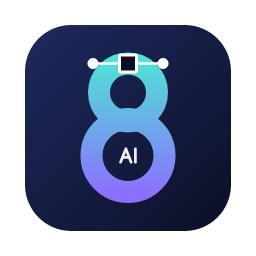

<p align="center"></p>

# AI8 Converter

A small desktop app (Windows and macOS) and command-line tool that converts
vector files to the **Adobe Illustrator 8** `.ai` format. Many vinyl cutters,
plotters, engravers, RIPs and older design programs read AI8 but not newer
formats.

- **Inputs:** EPS, PS, PDF, AI (both PDF-based Illustrator 9+ files and legacy PostScript-based ones), SVG, SVGZ and DXF (AutoCAD R12–R2018, ASCII or binary)
- **Output:** one Illustrator 8 file per page (`name.ai`, or `name_p1.ai`, `name_p2.ai`, … for multi-page input), and optionally a cleaned-up SVG (see [Fixed SVG](#fixed-svg))
- **What is kept:** paths, curves, compound paths, groups, clipping, fills and strokes (width, caps, joins, dashes), CMYK, RGB and grey colours, and spot colours (for example a `CutContour` cut line), plus overprint
- **Patterns and gradients:** tiling patterns (PDF tiling patterns, SVG `<pattern>`) and linear and radial gradients (PDF axial/radial shadings, SVG `<linearGradient>`/`<radialGradient>`) are carried over; see [Patterns and gradients](#patterns-and-gradients)
- **Text:** converted to outlines, so no fonts are needed on the receiving machine

## Ghostscript

EPS, PS and PostScript-based AI files are interpreted with
[Ghostscript](https://ghostscript.com), which has to be installed separately.
PDF and SVG files don't need it, but when Ghostscript is installed it's also
used to turn text in PDF files into outlines. You can switch that off in the
app, or with `--no-outline-text` on the command line.

Ghostscript is **not bundled** and is not part of AI8 Converter. It is separate
software by Artifex Software, Inc. under the [GNU AGPL
v3](https://www.gnu.org/licenses/agpl-3.0.html), and you install it yourself so
that you get it from Artifex under Artifex's own licence.

| Platform | Install |
| --- | --- |
| macOS | `brew install ghostscript` (or MacPorts `port install ghostscript`) |
| Windows | Run `Install Ghostscript.cmd` from the package, or `choco install ghostscript`, or the 64-bit installer from <https://ghostscript.com/releases/gsdnld.html>. Ghostscript is **not** in the Windows Package Manager: Artifex disabled the silent installer that winget requires. |
| Linux | your distribution's `ghostscript` package |

The app helps with this rather than shipping it: when none is detected, the
Ghostscript status line offers a **Get Ghostscript…** button, and **Re-detect**
picks it up afterwards without a restart. The Windows package contains
`Install Ghostscript.cmd`, and the Windows installer offers *Install
Ghostscript from Artifex* as an optional step that runs the same script. It
installs through Chocolatey when that is present, and otherwise opens Artifex's
download page; either way Ghostscript comes from Artifex, not from us.

The app looks for Ghostscript in this order:

1. The `AI8_GHOSTSCRIPT` environment variable (full path to the executable)
2. A copy placed next to the app: `<app folder>/gs/bin/gswin64c.exe` (Windows),
   `<app folder>/gs/bin/gs`, or `AI8 Converter.app/Contents/Resources/gs/bin/gs`
   (macOS). Released builds never contain one; this covers a copy you put there
   yourself, or an opt-in `--with-gs` build of your own.
3. `PATH` (`gswin64c.exe`, `gswin32c.exe` or `gs.exe` on Windows; `gs` elsewhere)
4. Standard install locations: `C:\Program Files\gs\gs*\bin\gswin64c.exe` (newest
   version wins) on Windows, and `/opt/homebrew/bin/gs`, `/usr/local/bin/gs` or
   `/opt/local/bin/gs` on macOS

You can also point the app at an executable with the **Browse…** button next to
the Ghostscript status line, or pass `--gs PATH` to the command-line tool. Each
Ghostscript run has a time limit of 120 seconds.

## Using the app

1. Drop files onto the window, or click **Add files…**. You can also drop a folder; the app adds the supported files directly inside it.
2. Pick the output location: **Same folder as source** or a folder you choose.
3. Pick the colour handling:
   - **Preserve:** keep colours as they are
   - **CMYK:** convert RGB and grey to CMYK
   - **RGB:** convert CMYK and grey to RGB

   Spot colours are always kept.
4. Pick the pattern handling (see [Patterns and gradients](#patterns-and-gradients)):
   - **Native Illustrator patterns:** pattern fills stay pattern swatches you can edit in Illustrator
   - **Expand to paths (for cutters):** each pattern fill is replaced by plain tile paths clipped to the filled shape
5. Click **Convert**. Each file shows *Pending*, *Converting*, *Done* (with its output paths and any warnings) or *Failed* (with the error). For a finished file, **Open output folder** shows the result.
6. **Save as SVG** on a file's row saves an SVG with the same cleaned-up paths (see [Fixed SVG](#fixed-svg)). It doesn't need the file to be converted first.
7. Check the result: **Preview** next to an output file shows the converted `.ai` file, the original, or both side by side (zoomable). **Open as PDF** writes a PDF rendering of the `.ai` file to a temporary folder and opens it in the system PDF viewer. Both need Ghostscript.

### Previewing the output

AI8 files are PostScript programs that rely on Illustrator's own procedure
sets, which (like Illustrator's "include: none" saves) are not stored in the
file. That is why macOS Preview, and Ghostscript on its own, cannot open
them. The app ships its own implementation of the AI8 operators
(`assets/ai8-procset.ps`, written from the Illustrator 7 file format
specification) and runs it with Ghostscript to draw the preview and the PDF.
The PDF is only for looking at: send the `.ai` file itself to the cutter or
to Illustrator.

If an output file would overwrite its input (an `.ai` input written next to
itself), `_ai8` is added to the output name.

## Command line

```
ai8conv [--out DIR] [--format ai|svg] [--color preserve|cmyk|rgb] [--patterns native|expand] [--no-outline-text] [--gs PATH] FILES...
```

```sh
ai8conv logo.eps                         # writes logo.ai next to logo.eps
ai8conv --out converted --color cmyk *.pdf *.svg
ai8conv --patterns expand pattern-fill.svg  # pattern fills as plain paths for a cutter
ai8conv --format svg drawing.svg         # writes drawing_fixed.svg (the input is not changed)
ai8conv --gs "C:\Program Files\gs\gs10.04.0\bin\gswin64c.exe" sticker.eps
```

The tool prints `input -> output` for each file written, and warnings and errors
on stderr. Exit status: `0` if every file converted, `1` if at least one failed,
`2` for a usage error.

## Building

You need a recent stable Rust toolchain (edition 2024, Rust 1.85 or later) from
<https://rustup.rs>.

```sh
cargo build --release            # GUI: target/release/ai8-converter(.exe)
                                 # CLI: target/release/ai8conv(.exe)
cargo test                       # Ghostscript tests are skipped if gs isn't installed
AI8_VISUAL_SAVE=1 cargo test --test visual   # also keep every rendering in target/visual-diff/
cargo run                        # start the GUI
cargo run --bin ai8conv -- --help
```

**Windows:** use the MSVC toolchain (the Visual Studio Build Tools with the
"Desktop development with C++" workload). Release builds of the GUI use the
Windows subsystem, so no console window appears. Ghostscript always runs
without a console window.

**macOS:** to build a double-clickable app bundle, run:

```sh
scripts/bundle-macos.sh               # target/release/bundle/AI8 Converter.app (+ .zip)
scripts/bundle-macos.sh --universal   # Apple Silicon + Intel (needs both rustup targets)
scripts/bundle-macos.sh --gs-dir DIR  # also bundle a self-contained Ghostscript
```

The bundle has an ad-hoc signature only. On another Mac, the first launch may
need right-click → **Open**, or `xattr -dr com.apple.quarantine "AI8 Converter.app"`.

## Fixed SVG

Both the `.ai` output and the SVG export clean up the paths for laser and
cutter software:

- Every closed shape ends exactly on its start point, with the closing edge
  written out. Some laser programs only draw the edges that are in the file,
  so a shape whose last edge was implied lost that edge in outline view.
- A closed shape whose end point misses its start by less than 0.1 pt
  (0.035 mm) is closed exactly instead of getting a tiny extra edge.
- Zero-length segments (such as `h0` in Illustrator SVG exports) are removed.
- Open paths keep any gap.

The SVG export (**Save as SVG** in the app, `--format svg` on the command
line) writes `name.svg`, one per page for multi-page input. For an SVG input
it always writes a new copy, `name_fixed.svg`, and never changes the
original. The SVG is in points at the same physical size as the original. Groups, clipping, strokes, patterns and gradients
are kept. Colours are written as RGB: CMYK and spot colours are converted
the way Ghostscript and Illustrator display them (100% cyan becomes
`#00aeef`), and spot colour names are not kept. The **Patterns** setting
applies to the SVG as well, and text becomes outlines.

## Patterns and gradients

Pattern fills and strokes are written in one of two ways, chosen with the
**Patterns** setting in the app or `--patterns` on the command line:

- `native` (default): each pattern becomes an Illustrator pattern swatch and
  the shapes are filled or stroked with it, so the result stays editable in
  Illustrator. A pattern used inside another pattern is expanded into plain
  tile paths inside the outer swatch, and gradients inside a pattern tile
  become flat colours.
- `expand`: each pattern fill is replaced by copies of the tile artwork,
  clipped to the shape. A pattern stroke is expanded the same way inside the
  stroke's outline (dashes, caps and joins included). Use this for cutters,
  plotters and RIPs that don't understand pattern fills.

Linear and radial gradients are written as Illustrator gradients with their
colour stops and geometry (start and end point, centre, radius and focal
point).

SVG details: `patternUnits`, `patternContentUnits`, `patternTransform`,
`viewBox` on patterns, `gradientUnits`, `gradientTransform` and `href`
inheritance are all supported. A `<pattern>` used by several shapes becomes
one swatch, named after its `id`.

**CI:** `.github/workflows/build.yml` builds and tests on `windows-latest` and
`macos-latest` with Ghostscript installed. It uploads the Windows `.exe` files
and the zipped macOS `.app` as artifacts.

## Limitations

- Raster images are not converted. They are dropped and a warning is shown.
- Transparency (opacity, soft masks, blend modes) is not converted, and a warning is shown. This includes gradient `stop-opacity`.
- SVG gradient `spreadMethod="reflect"`/`"repeat"` is written as `pad`, and a radial gradient's focal radius (`fr`) is ignored; both show a warning. Shading types other than linear and radial are approximated by a flat colour.
- Text always becomes outlines; no editable text is written. A PDF with live text that is converted without Ghostscript (or with outlining off) loses that text, and a warning is shown.
- SVG filters, masks and embedded bitmaps are not supported. CSS and `<use>` are supported. SVG `<text>` is outlined with the fonts installed on the computer, so a missing font falls back to a substitute.
- The output is a plain AI8 file: one layer, and no embedded preview or procsets. Illustrator and AI-importing applications read it directly, but sending it straight to a PostScript printer won't work, and macOS Preview can't open it (use **Preview** or **Open as PDF** in the app).
- DXF: text (TEXT, MTEXT, attribute and dimension text, SHX fonts) is not converted; 3D entities are projected flat (top view); hatch patterns become native pattern swatches when their line families repeat on a common lattice (ANSI31, crosshatches, bricks, …), otherwise clipped dashed lines; hatch gradients become linear or radial gradients. Drawings without units are taken as millimetres.
- In expand mode, a pattern stroke whose outline would have more than 5,000 segments (for example a very long dashed line), and patterns nested more than 4 deep, get a flat colour; a warning is shown.
- Ghostscript is never bundled in a release and must be installed separately for EPS/PS input; the app offers to install it for you. Mind its AGPL licence if you build a bundled copy and redistribute that.

## Licence

AI8 Converter is free and open source under the [MIT Licence](LICENSE) —
Copyright (c) 2026 Asbjørn Pettersen.

You may use, modify and redistribute it, including commercially and in closed
source products, provided the copyright notice and the licence text are kept
in copies and substantial portions of the software. There is no warranty.

### Third-party components

The compiled program links a number of permissively licensed Rust crates (MIT,
Apache-2.0, BSD, Zlib, ISC, OFL-1.1 for the bundled default fonts). Their
notices are collected in [THIRD-PARTY-NOTICES.txt](THIRD-PARTY-NOTICES.txt),
which is regenerated with `scripts/gen-third-party-notices.sh` and ships in the
Windows and macOS packages.

Ghostscript is a **separate program** under the
[GNU AGPL v3](https://www.gnu.org/licenses/agpl-3.0.html), owned by Artifex
Software, Inc. AI8 Converter runs it as a child process over its command-line
interface and contains no Ghostscript code, so the two are an aggregate rather
than a combined work and the MIT licence above is unaffected.

**No release bundles it, and the Windows packaging cannot.** Users install it
themselves, receiving it from Artifex under Artifex's licence, which keeps this
project free of AGPL redistribution duties. The macOS script can still build a
self-contained copy into the app with the opt-in `--with-gs` flag, for your own
machine or an offline deployment; redistributing such a build makes *you* an
AGPL distributor, obliged to supply the corresponding source for that exact
build. Linking Ghostscript as a library instead of running it as a process
would make the result a combined work and bring the whole program under the
AGPL, so AI8 Converter never does that.

### Trademarks

Adobe, Adobe Illustrator and PostScript are trademarks of Adobe Inc. AI8
Converter is not affiliated with, endorsed by or sponsored by Adobe. Those
names are used only to describe the file formats this tool reads and writes.
The AI8 format support is an independent implementation written from the
published *Adobe Illustrator File Format Specification* and from observing
files produced by Illustrator; see
[docs/ai8-format-notes.md](docs/ai8-format-notes.md).
